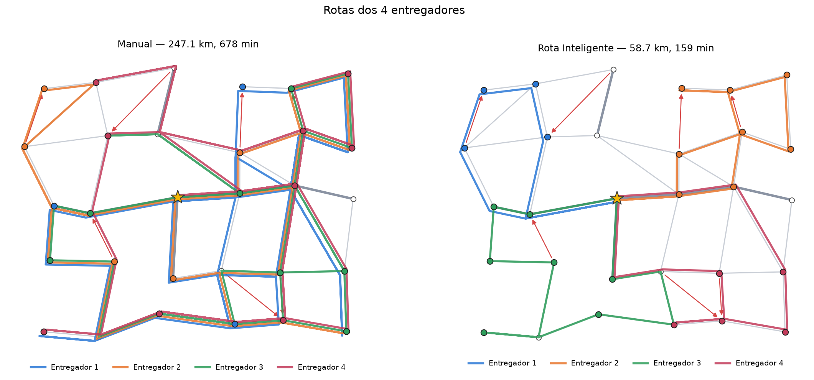
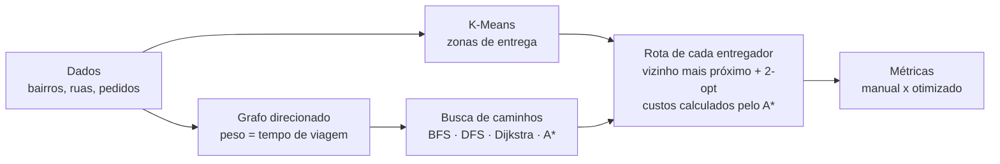
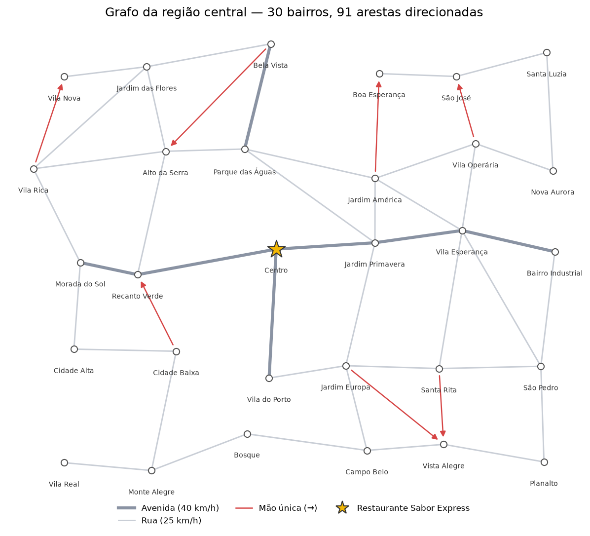
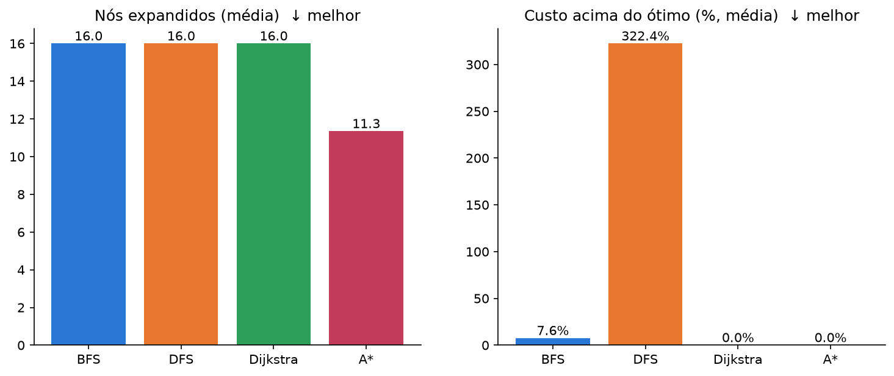
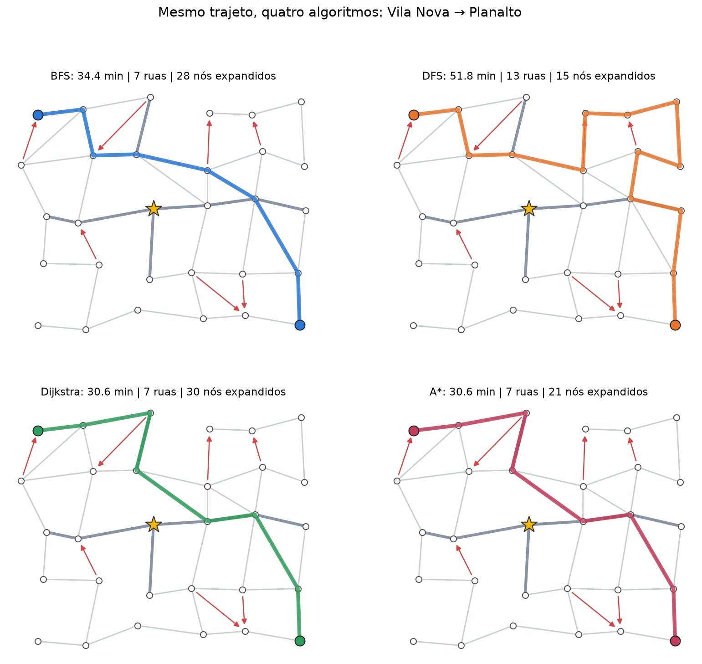
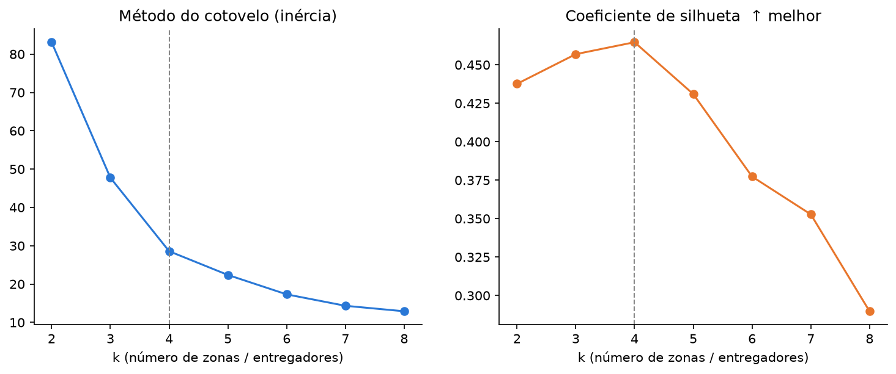
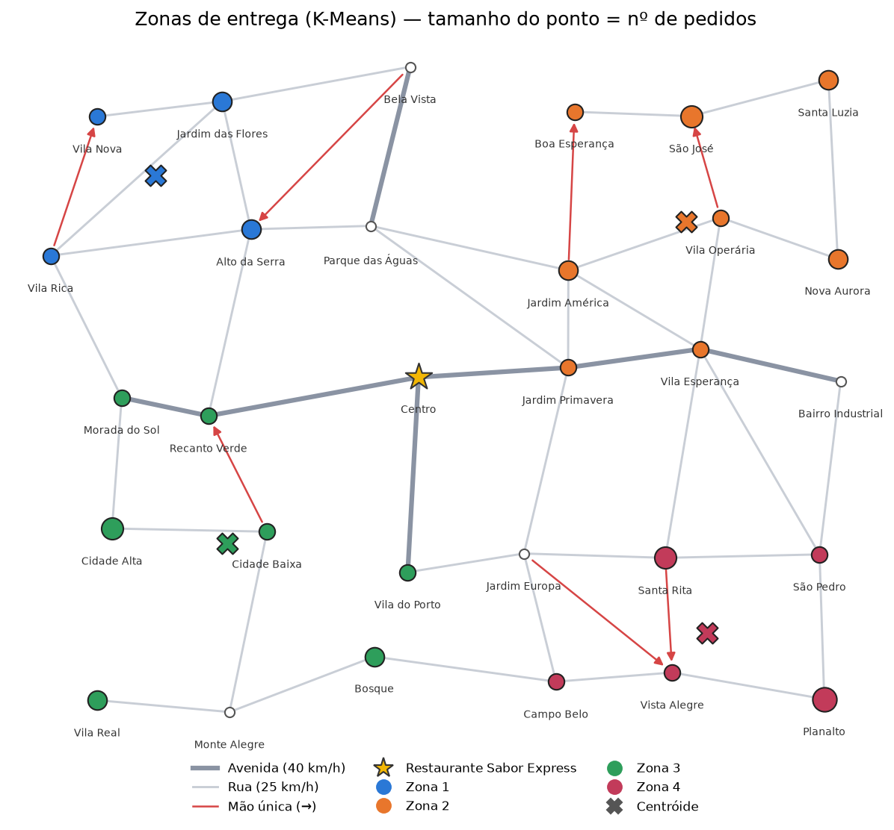
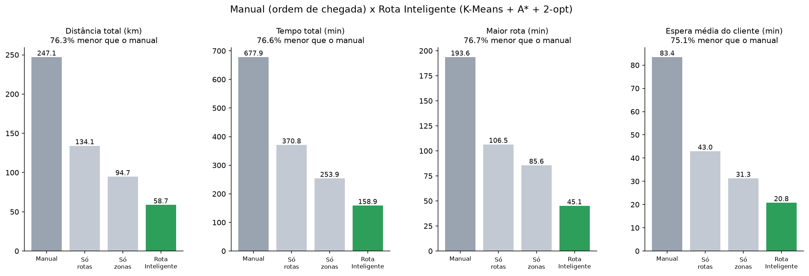

# Rota Inteligente: Otimização de Entregas com Algoritmos de IA

Projeto da disciplina **Artificial Intelligence Fundamentals** (UNIFECAF).

**Aluno:** Gustavo Paraiso Vizeu · **RA:** 160207

🎬 **Vídeo pitch:** https://youtu.be/QqQ4B4fhrAM

Solução de roteamento para a **Sabor Express**, empresa de delivery de alimentos da região central da cidade, usando **grafos**, **algoritmos de busca (BFS, DFS, Dijkstra e A\*)** e **aprendizado não supervisionado (K-Means)**.

> **Resultado principal:** no horário de pico simulado (40 pedidos, 4 entregadores), a Rota Inteligente reduziu a **distância total em 76%** (247 km → 59 km) e a **espera média do cliente de 83 para 21 minutos**, em comparação com a distribuição manual por ordem de chegada.



---

## Sumário
1. [Problema, desafio e objetivos](#1-problema-desafio-e-objetivos)
2. [Abordagem adotada](#2-abordagem-adotada)
3. [Algoritmos utilizados](#3-algoritmos-utilizados)
4. [Modelo do grafo (diagrama)](#4-modelo-do-grafo)
5. [Resultados](#5-resultados)
6. [Eficiência, limitações e melhorias](#6-eficiência-limitações-e-melhorias)
7. [Como executar](#7-como-executar)
8. [Estrutura do repositório](#8-estrutura-do-repositório)
9. [Referências](#9-referências)

---

## 1. Problema, desafio e objetivos

**Problema.** A Sabor Express enfrenta atrasos nos horários de pico (almoço e jantar). As rotas são definidas manualmente, com base apenas na experiência dos entregadores, o que gera trajetos longos, mais gasto de combustível e clientes insatisfeitos.

**Desafio.** Desenvolver uma solução de IA que sugira as melhores rotas, tratando a cidade como um **grafo** (bairros = nós, ruas = arestas com peso de distância ou tempo), encontrando o **menor caminho entre múltiplos pontos de entrega** e, quando há muitos pedidos, **agrupando entregas próximas** com clustering.

**Objetivos.**
- Modelar a região central como um grafo ponderado e direcionado, com restrições urbanas (ruas de mão única, avenidas mais rápidas, trânsito mais lento perto do Centro).
- Implementar e comparar BFS, DFS, Dijkstra e A\* para o menor caminho entre dois pontos.
- Dividir os pedidos em zonas de entrega com K-Means (uma zona por entregador).
- Montar a rota de cada entregador passando por todas as paradas e voltando ao restaurante.
- Medir o ganho em relação ao processo manual atual com métricas objetivas.

## 2. Abordagem adotada



1. **Dados** (`src/gerar_dados.py`): 30 bairros fictícios em uma área de ~6 x 5 km, 49 ruas e 40 pedidos do pico do almoço (11:30–12:29). O restaurante fica no **Centro**. Os dados são sintéticos e gerados com semente fixa, então qualquer pessoa obtém exatamente os mesmos resultados.
2. **Grafo** (`src/grafo.py`): cada rua tem distância (km), tipo de via (avenida 40 km/h, rua 25 km/h) e fator de trânsito (1,4–1,8 perto do Centro). O peso padrão é o **tempo de viagem em minutos**:
   `tempo = distância / velocidade × 60 × fator_trânsito`.
   Ruas de mão única geram uma só aresta, por isso o grafo é **direcionado**.
3. **Busca** (`src/busca.py`): os quatro algoritmos foram implementados do zero e comparados em todos os 870 pares origem-destino.
4. **Agrupamento** (`src/agrupamento.py`): o K-Means agrupa os bairros com pedidos pelas coordenadas. O número de zonas *k* parte do mínimo exigido pela capacidade de cada entregador (6 paradas) e é escolhido pelo **coeficiente de silhueta**.
5. **Roteamento** (`src/roteamento.py`): a rota de cada zona é um problema do caixeiro-viajante (TSP) pequeno. O A\* calcula o custo entre cada par de paradas, a heurística do **vizinho mais próximo** gera uma rota inicial e o **2-opt** a melhora.
6. **Avaliação** (`src/metricas.py`): compara o cenário **manual** (pedidos divididos por ordem de chegada e entregues nessa ordem) com a **Rota Inteligente**, e ainda isola o efeito de cada técnica.

## 3. Algoritmos utilizados

| Algoritmo | Ideia | Garante o menor custo? | Complexidade |
|---|---|---|---|
| **BFS** (busca em largura) | Explora por "camadas"; acha o caminho com **menos ruas** | Não (ignora o peso) | O(V + E) |
| **DFS** (busca em profundidade) | Segue um caminho até o fim antes de voltar | Não | O(V + E) |
| **Dijkstra** (custo uniforme) | Expande sempre o nó de menor custo acumulado g(n) | Sim | O((V + E) log V) |
| **A\*** | Expande o nó de menor f(n) = g(n) + h(n) | Sim, com h admissível | O((V + E) log V), na prática expande menos nós |
| **K-Means** | Agrupa pontos minimizando a distância ao centróide do grupo | — | O(n · k · iterações) |
| **Vizinho mais próximo + 2-opt** | Constrói a rota e depois inverte trechos enquanto houver melhora | Não (heurística); ficou a ≤ 10% do ótimo nos testes | O(n²) por passada do 2-opt |

**Heurística do A\*.** Para o peso *tempo*, h(n) = distância em linha reta até o destino ÷ velocidade máxima (40 km/h). Nenhuma rua é mais curta que a linha reta, nenhuma é mais rápida que 40 km/h e o trânsito só aumenta o tempo. Logo, h(n) **nunca superestima** o custo real (é admissível) e o A\* sempre encontra o caminho ótimo. Isso é verificado no teste `test_heuristica_admissivel`.

**Por que BFS e DFS não bastam.** O BFS minimiza o número de ruas, não o tempo: uma rua longa e congestionada "vale" o mesmo que uma avenida rápida. O DFS devolve o primeiro caminho que encontra, que costuma ser muito ruim. Eles entram como base de comparação.

## 4. Modelo do grafo



- **30 nós** (bairros) com coordenadas em km. A estrela é o restaurante (Centro).
- **91 arestas direcionadas**: 42 ruas de mão dupla (2 arestas cada) + 7 de mão única (setas vermelhas).
- **Avenidas** (cinza escuro) cruzam o Centro e são mais rápidas, mas o trânsito do Centro as deixa mais lentas no pico.

Arquivos de dados: [`data/bairros.csv`](data/bairros.csv), [`data/ruas.csv`](data/ruas.csv), [`data/pedidos.csv`](data/pedidos.csv).

## 5. Resultados

### 5.1 Comparação dos algoritmos de busca (870 pares origem-destino, peso = tempo)

| Algoritmo | Caminho ótimo | Custo acima do ótimo (média) | Nós expandidos (média) |
|---|---|---|---|
| BFS | 52,9% dos pares | +7,6% | 16,0 |
| DFS | 9,3% dos pares | +322,4% | 16,0 |
| Dijkstra | 100% | 0% | 16,0 |
| **A\*** | **100%** | **0%** | **11,3 (−29%)** |



O A\* encontra o mesmo caminho ótimo que o Dijkstra, mas expande **29% menos nós**, porque a heurística o orienta na direção do destino. Por coincidência matemática, BFS, DFS e Dijkstra têm a mesma média de nós expandidos: os três percorrem os 30 bairros em alguma ordem até chegar ao destino e, na média de todos os destinos possíveis, param na mesma posição.

Exemplo **Vila Nova → Planalto**: BFS 34,4 min, DFS 51,8 min, Dijkstra e A\* 30,6 min. O A\* expandiu 21 nós contra 30 do Dijkstra.



### 5.2 Agrupamento das entregas (K-Means)

Os 40 pedidos caem em **24 bairros distintos**. Com capacidade de 6 paradas por entregador, são necessárias pelo menos ⌈24/6⌉ = 4 zonas. Entre k = 4 e 8, **k = 4** teve a maior silhueta (0,465), e também é o "cotovelo" da curva de inércia.

| Cotovelo e silhueta | Zonas formadas |
|---|---|
|  |  |

### 5.3 Rotas finais

| Entregador | Pedidos | Tempo | Distância | Rota |
|---|---|---|---|---|
| 1 | 6 | 32,4 min | 11,6 km | Centro → Vila Rica → Vila Nova → Jardim das Flores → Alto da Serra → Centro |
| 2 | 13 | 41,7 min | 15,5 km | Centro → Jardim Primavera → Vila Esperança → Vila Operária → São José → Boa Esperança → Santa Luzia → Nova Aurora → Jardim América → Centro |
| 3 | 11 | 45,1 min | 16,9 km | Centro → Vila do Porto → Bosque → Vila Real → Cidade Baixa → Cidade Alta → Morada do Sol → Recanto Verde → Centro |
| 4 | 10 | 39,7 min | 14,7 km | Centro → Santa Rita → Vista Alegre → Campo Belo → Planalto → São Pedro → Centro |

### 5.4 Manual x Rota Inteligente

| Cenário | Distância total | Tempo total | Maior rota | Espera média do cliente | Espera máxima |
|---|---|---|---|---|---|
| Manual (lotes por ordem de chegada) | 247,1 km | 677,9 min | 193,6 min | 83,4 min | 178,5 min |
| Só roteamento (lotes por chegada + 2-opt) | 134,1 km | 370,8 min | 106,5 min | 43,0 min | 88,1 min |
| Só agrupamento (K-Means + ordem de chegada) | 94,7 km | 253,9 min | 85,6 min | 31,3 min | 69,5 min |
| **Rota Inteligente (K-Means + A\* + 2-opt)** | **58,7 km** | **158,9 min** | **45,1 min** | **20,8 min** | **39,8 min** |
| **Redução** | **−76,3%** | **−76,6%** | **−76,7%** | **−75,1%** | **−77,7%** |



**Leitura dos resultados.**
- O **agrupamento** é a técnica de maior impacto isolado (−62% de distância): com zonas compactas, o entregador para de cruzar a cidade de um lado para o outro.
- O **roteamento** sozinho também ajuda (−46%), mas não resolve o problema de lotes espalhados.
- **Combinados**, os dois cortam ¾ da distância. A espera média do cliente cai de 83 para 21 minutos, um ganho direto de satisfação, e a menor quilometragem reduz o custo de combustível.

Tabelas completas: [`outputs/metricas_manual_vs_otimizado.csv`](outputs/metricas_manual_vs_otimizado.csv), [`outputs/rotas.csv`](outputs/rotas.csv), [`outputs/comparacao_algoritmos.csv`](outputs/comparacao_algoritmos.csv), e a saída completa do programa em [`outputs/execucao.txt`](outputs/execucao.txt).

## 6. Eficiência, limitações e melhorias

**Eficiência.** A execução completa leva poucos segundos. Cada busca A\* leva menos de 0,1 ms neste grafo, e a matriz de custos entre as 25 paradas exige 600 buscas. O 2-opt é O(n²) por passada, adequado para zonas de até algumas dezenas de paradas. Os testes mostram que a rota obtida fica a no máximo 10% do ótimo calculado por força bruta.

**Limitações.**
- **Dados sintéticos:** o mapa é fictício. Os números mostram a tendência, não a economia exata de uma cidade real.
- **Trânsito estático:** os tempos representam um pico médio e não mudam ao longo do dia.
- **K-Means usa distância em linha reta**, não a distância real pelas ruas. Dois bairros próximos, mas separados por uma rua de mão única, podem cair na mesma zona.
- **Zonas desbalanceadas:** o K-Means não limita o tamanho dos grupos. O entregador 2 recebeu 13 pedidos em 8 paradas, acima da capacidade desejada de 6.
- **Sem janelas de tempo, prioridade ou capacidade da bag:** todos os pedidos são tratados como igualmente urgentes.
- **Baseline simplificado:** o cenário manual é uma aproximação do processo atual; entregadores experientes provavelmente fariam rotas melhores que a ordem de chegada pura.

**Sugestões de melhoria.**
- Usar mapas reais (OpenStreetMap via `osmnx`) e tempos de trânsito em tempo real (APIs de tráfego).
- Clustering com restrição de capacidade (K-Means balanceado) ou DBSCAN usando a distância real pelas ruas.
- Tratar o problema completo como **VRP com janelas de tempo** (Programação Linear Inteira Mista, OR-Tools) ou com **algoritmos genéticos**.
- Re-otimizar a rota a cada novo pedido (roteamento dinâmico), como faz o sistema **ORION da UPS**.
- Prever demanda por bairro e horário para posicionar entregadores antes do pico.

## 7. Como executar

Requisitos: **Python 3.10+**.

```bash
# 1. Clonar o repositório
git clone https://github.com/gustviz/rota-inteligente-sabor-express.git
cd rota-inteligente-sabor-express

# 2. Criar e ativar um ambiente virtual
python -m venv .venv
# Windows:      .venv\Scripts\activate
# Linux/macOS:  source .venv/bin/activate

# 3. Instalar as dependências
pip install -r requirements.txt

# 4. (Opcional) Regerar os dados — os CSVs já estão em /data
python src/gerar_dados.py --seed 42 --pedidos 40

# 5. Rodar a solução completa (gera tabelas e gráficos em /outputs)
python src/main.py

# 6. Rodar os testes
python -m pytest -q
```

Opções do `main.py`:

| Opção | Padrão | Descrição |
|---|---|---|
| `--peso` | `tempo_min` | Peso a minimizar: `tempo_min` ou `distancia_km` |
| `--capacidade` | `6` | Máximo desejado de paradas por entregador (define o k mínimo) |
| `--origem` / `--destino` | `Vila Nova` / `Planalto` | Bairros do exemplo de busca |

Exemplo: `python src/main.py --peso distancia_km --capacidade 8 --origem "Vila Real" --destino "Santa Luzia"`

## 8. Estrutura do repositório

```
├── data/                 # bairros.csv, ruas.csv, pedidos.csv
├── src/
│   ├── gerar_dados.py    # gera a cidade e os pedidos (semente fixa)
│   ├── grafo.py          # classe Grafo, carga dos CSVs e heurística do A*
│   ├── busca.py          # BFS, DFS, Dijkstra e A* (implementados do zero)
│   ├── agrupamento.py    # K-Means, cotovelo e silhueta
│   ├── roteamento.py     # matriz de custos, vizinho mais próximo e 2-opt
│   ├── metricas.py       # comparação de algoritmos e de cenários
│   ├── visualizacao.py   # mapas e gráficos
│   └── main.py           # executa todo o fluxo
├── outputs/              # gráficos, tabelas CSV e log da execução
├── tests/                # testes automatizados (pytest)
└── requirements.txt
```

## 9. Referências

- UPS — *ORION (On-Road Integrated Optimization and Navigation)*: estudo de caso de otimização de rotas de entrega.
- *Optimizing Logistics: Clustering e MILP* (Medium): K-Means, DBSCAN e Programação Linear Inteira Mista para agrupar entregas.
- *AI-Powered Route Optimization* (ResearchGate): heurísticas, algoritmos genéticos e aprendizado por reforço para roteamento dinâmico.
- Kardinal.ai — *Fresh Product Delivery*: otimização contínua de rotas para entrega de alimentos.
- RUSSELL, S.; NORVIG, P. *Inteligência Artificial: Uma Abordagem Moderna*. Capítulo 3 (busca heurística e A\*).
